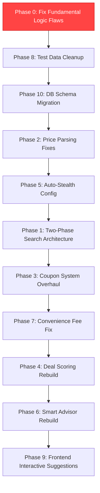

# Flight Finder — Comprehensive Fix & Enhancement Plan (v2)

This plan addresses **every issue** identified from a thorough audit of the codebase, your reported problems, **and newly discovered fundamental logic flaws** that would silently produce wrong results. The new issues are in **Phase 0** — they are the most impactful bugs in the program.

---

## 🔴 NEWLY DISCOVERED FUNDAMENTAL LOGIC FLAWS

> [!CAUTION]
> These are **critical architectural bugs** that the original plan completely missed. Each one silently corrupts the program's core output — the "best deal" it shows the user. Fixing these will make the **biggest difference** to result quality.

### Flaw #1: Only ONE Flight Per Platform — The "Best Deal" Is a Lie

**Severity**: 🔴 CRITICAL  
**Files**: [dispatcher.py](file:///c:/Users/yasha/Desktop/Flight%20Finder/backend/dispatcher.py#L420) (line 420), [dispatcher.py](file:///c:/Users/yasha/Desktop/Flight%20Finder/backend/dispatcher.py#L256-L261)

**What's broken**: The dispatcher scrapes *multiple* flights from each platform, but then **immediately discards all but one** — either `flights[0]` (the first result) or a specific flight number match. Only this single flight's price is saved, scored, and shown to the user.

```python
# Line 420 — THE BUG:
selected_flight = flights[0]  # Throws away ALL other cheaper flights!
```

**Why this is devastating**: 
- The worker might scrape 15 flights from Cleartrip. Flight #7 might be ₹3,200 while flight #1 is ₹5,600. But the user only ever sees ₹5,600.
- The "cheapest flight" claim in logs (`Cheapest flight: Rs. {final_price}`) is **a lie** — it's just the first DOM element, not the cheapest.
- Deal scoring, savings calculations, and all downstream logic operate on this **arbitrarily chosen** flight, not the actual best deal.
- The entire program's **core value proposition** (finding the cheapest flight across platforms) is broken at the most fundamental level.

**Fix**: For real platform workers, iterate over ALL scraped flights (or at minimum the top 5 cheapest), apply coupon matching to each, save each as a separate result, score each independently, and let the frontend rank them.

---

### Flaw #2: Fake Flight Numbers Destroy Cross-Platform Comparison

**Severity**: 🔴 CRITICAL  
**Files**: [cleartrip_worker.py](file:///c:/Users/yasha/Desktop/Flight%20Finder/backend/workers/cleartrip_worker.py#L161-L172), [easemytrip_worker.py](file:///c:/Users/yasha/Desktop/Flight%20Finder/backend/workers/easemytrip_worker.py#L203-L215), [makemytrip_worker.py](file:///c:/Users/yasha/Desktop/Flight%20Finder/backend/workers/makemytrip_worker.py)

**What's broken**: When DOM parsing can't find the real flight number, workers **generate random fake flight numbers**:

```javascript
// Line 163 — THE BUG:
flight_number = "6E-" + Math.floor(100 + Math.random() * 900);
```

**Why this is devastating**:
- The **same IndiGo 6E-2051 flight** on Cleartrip might get tagged as `6E-427`, and on EaseMyTrip as `6E-813`. They look like completely different flights.
- The user **cannot compare the same flight across platforms** — which is the entire point of a multi-platform search tool.
- Price history in the database gets polluted with phantom flight numbers (`6E-427` at ₹4,800 on one search, `6E-813` at ₹4,800 on the next search) — no historical trend can be computed.
- The `specific_flight_number` matching feature in dispatcher is useless because it compares user input against random strings.
- Any deduplication or "same flight, different price" comparison is impossible.

**Fix**: Extract actual flight numbers from DOM text using regex patterns (e.g., `/\b(6E|AI|UK|SG|QP|I5)\s*[-]?\s*(\d{3,4})\b/`). If not found, generate a deterministic hash from `airline + departure_time + arrival_time` to ensure the same physical flight always gets the same ID across platforms.

---

### Flaw #3: Geo-Location Price Differential Is Completely Fake

**Severity**: 🟡 MAJOR  
**File**: [dispatcher.py](file:///c:/Users/yasha/Desktop/Flight%20Finder/backend/dispatcher.py#L346-L380)

**What's broken**: The dispatcher logs "Geo-Location price differential detected" and saves a "Tier 3" price to the database, but **the differential is just `random.choice([120.0, 180.0, 250.0, 0.0])`** — a random number. No actual geo-location scraping happens.

```python
# Line 358 — THE BUG:
location_price_diff = random.choice([120.0, 180.0, 250.0, 0.0])
t3_price = final_price - location_price_diff
```

**Why this is devastating**:
- A **completely fabricated price** gets saved to `observed_prices` with the route key `DEL-GOI_TIER3`. This fake data **feeds back into the deal scorer and price predictor**.
- The price predictor queries `observed_prices` to train its Prophet model (line 173-178 of price_predictor.py). Random noise injected into this table degrades prediction accuracy over time.
- The log message makes it appear the system has sophisticated geo-pricing intelligence, but it's pure theater.

**Fix**: Remove the fake geo-location price differential entirely. Only log real observed prices from actual scrapes. If real geo-pricing is desired later, it should use actual proxy-routed scrapes with separate browser sessions.

---

### Flaw #4: `price_predictor.py` Has Hardcoded Fake Scenarios & Alternative Suggestions

**Severity**: 🟡 MAJOR  
**File**: [price_predictor.py](file:///c:/Users/yasha/Desktop/Flight%20Finder/backend/price_predictor.py#L349-L441)

**What's broken**: While the implementation plan addresses hardcoded suggestions in `smart_advisor.py`, the **price predictor has its OWN separate copy of hardcoded fake suggestions** that bypasses the advisor entirely:

```python
# Line 361 — hardcoded scenario note:
"note": "IndiGo flash sale expected Tuesday. 65% probability of discount."  # FAKE

# Line 367 — hardcoded scenario note:
"note": "Monsoon discounts start kicking in, but close to travel window."  # FAKE

# Line 373 — hardcoded scenario note:
"note": "Diwali demand surge building. Avoid waiting this long."  # FAKE

# Line 381 — random savings:
date_shift_savings = random.choice([250, 400, 600])  # FAKE

# Line 421 — random layover savings:
layover_savings = random.choice([350, 650, 1000])  # FAKE
```

**Why this is devastating**:
- The predictor returns `smart_suggestions` and `scenarios` with **fabricated savings numbers and made-up airline sale claims**. These go directly to the frontend.
- This is a **SECOND source of fake data** independent of the smart_advisor.py fakes. Fixing the advisor alone won't fix this — the predictor injects its own fake suggestions.
- The `current_best_platform` and `current_best_coupon` fields are hardcoded: `"EaseMyTrip"` and `"EMTFLY"` (line 453-454) regardless of what was actually found.

**Fix**: Strip all hardcoded scenarios and alternatives from the predictor. The predictor should only return forecasting data (signals, confidence, price bands). Smart suggestions should come exclusively from `smart_advisor.py` based on real scraped data.

---

### Flaw #5: The Entire `final_price` vs `savings_breakdown["checkout_price"]` Mismatch

**Severity**: 🔴 CRITICAL  
**File**: [dispatcher.py](file:///c:/Users/yasha/Desktop/Flight%20Finder/backend/dispatcher.py#L457-L491)

**What's broken**: For real platform workers, the `final_price` saved in the result dict is **different from what the savings stacker calculates**:

```python
# Line 457: final_price is set BEFORE convenience fee
final_price = selected_flight["base_price"] - savings

# Line 462-466: savings_stacker ADDS convenience fee to checkout_price
savings_breakdown = await self.savings_stacker.calculate_all_savings(
    platform=platform,
    checkout_price=final_price,  # ← This is base_price - coupon savings
    ...
)

# Line 491: BUT the saved result uses savings_breakdown["checkout_price"]
"final_price": savings_breakdown["checkout_price"],  # ← This has convenience fee ADDED BACK
```

So the result's `final_price` = `(base_price - coupon_savings) + convenience_fee`. But `savings` is still `coupon_savings` only. This means:
- `base_price - savings ≠ final_price` (because convenience fee was silently added)
- The deal score was calculated on the **pre-fee** price (line 470), but the price shown to the user has the fee included
- `effective_price` is calculated from the fee-inflated price, making the savings breakdown inconsistent

Meanwhile, the mock worker pipeline at line 300-310 passes `final_price` (post-coupon) to the stacker, but then uses `effective_price` for display — a **different calculation path** than real workers. Same code, two different accounting methods.

**Fix**: Establish a single, clear pricing pipeline: `scraped_price → coupon_discount → post_coupon_price → convenience_fee → final_checkout_price → auxiliary_savings → effective_price`. Each variable should have one unambiguous meaning, used consistently in both mock and real paths.

---

### Flaw #6: Nearby Date Scanning Runs on the WRONG Platform

**Severity**: 🟡 MAJOR  
**File**: [dispatcher.py](file:///c:/Users/yasha/Desktop/Flight%20Finder/backend/dispatcher.py#L526-L569)

**What's broken**: Nearby date scanning (±2 days) runs **after** the main scrape completes, using the **same worker and same browser session** that just finished scraping results. The problem:

1. It reuses the same browser page, which may have navigated away from the search results (e.g., to a checkout or coupon page during the mock pipeline)
2. The date alternatives' `savings` are computed against `final_price` (which already has coupon discounts applied), not against the original scraped price. So if a coupon saved ₹800 on the target date but no coupon was tested on nearby dates, the comparison is apples-to-oranges: `(coupon-discounted price on target date) - (raw scraped price on nearby date)`.
3. The nearby date scanning is inside the per-platform worker pipeline, so if 3 platforms are running, **each platform scans nearby dates independently**. This means 3× the browser activity, 3× the anti-bot risk, and potentially 3 different "cheapest nearby date" answers.
4. Nearby date prices are compared to `final_price` which is the **coupon-discounted** target date price. If the coupon saves ₹500 on target date, nearby dates will appear ₹500 more expensive than they actually are.

**Fix**: Move nearby date scanning to Phase 1 (Google Flights only, as proposed in the original plan), OR run it once on the cheapest platform post-comparison. Compare raw scraped prices only (not coupon-discounted).

---

### Flaw #7: Hardcoded Fallback Flights Silently Replace Real Data

**Severity**: 🟡 MAJOR  
**Files**: [cleartrip_worker.py](file:///c:/Users/yasha/Desktop/Flight%20Finder/backend/workers/cleartrip_worker.py#L80-L92), [easemytrip_worker.py](file:///c:/Users/yasha/Desktop/Flight%20Finder/backend/workers/easemytrip_worker.py#L98-L110)

**What's broken**: When both DOM parsing and LLM vision fail, the workers return a **hardcoded fake flight** as a "last resort fallback":

```python
# Cleartrip returns a fake Vistara flight at ₹5,600
return [{"flight_number": "UK-821", "airline": "Vistara", "base_price": 5600.0, ...}]

# EaseMyTrip returns a fake IndiGo flight at ₹5,200
return [{"flight_number": "6E-2051", "airline": "IndiGo", "base_price": 5200.0, ...}]
```

**Why this is devastating**:
- The user sees a "Vistara UK-821 at ₹5,600 on Cleartrip" result that **doesn't exist**. If they try to book it, the flight won't be there.
- These fake results get saved to `search_results`, logged to `price_history`, fed into `observed_prices`, and used to train the ML price predictor.
- Deal scoring runs on these fake prices, producing scores that have no connection to reality.
- The system reports "completed" status — the user has **no indication** that results are fabricated.

**Fix**: When all extraction fails, return an empty list and let the dispatcher report the platform as `failed` rather than injecting phantom flights. Add a `data_source` field (`"dom"`, `"vision"`, `"fallback"`) to each result so the user knows the confidence level.

---

### Flaw #8: Payment Method Savings Stack Illegally — User Can't Use CashKaro AND UPI Offer Simultaneously

**Severity**: 🟡 MAJOR  
**File**: [savings_stacker.py](file:///c:/Users/yasha/Desktop/Flight%20Finder/backend/savings_stacker.py#L137-L142)

**What's broken**: The stacker picks the best cashback portal AND the best payment method (card/wallet/UPI), then adds them together:

```python
# Line 141:
total_aux_savings = best_cashback_portal["amount"] + best_payment_method["amount"]
```

But in reality:
- If you pick **CashKaro** (cashback portal) AND pay via **Amazon Pay** (wallet offer), the wallet offer typically has its own separate terms that may conflict with the portal cashback.
- If you use **CashKaro + HDFC Card**, CashKaro's cashback often requires payment through specific methods. Many portals void cashback if you pay via specific wallets.
- **Wallet and UPI offers are mutually exclusive with card rewards** — you can only pay with one method. But the stacker compares wallet vs UPI vs card and picks the best, which is correct. However, it then stacks this with cashback portal savings without checking compatibility.

**Fix**: Add mutual exclusivity rules. Cashback portal savings should be validated against the chosen payment method. If CashKaro requires card payment but the best savings come from a wallet, the stacker should compute both combinations and pick the one with the highest total.

---

## Issue Summary (Updated — includes original + newly discovered)

| # | Issue | Severity | Status |
|---|-------|----------|--------|
| **NEW-1** | **Only 1 flight per platform saved — discards all other results** | 🔴 Critical | **NEW** |
| **NEW-2** | **Random fake flight numbers break cross-platform comparison** | 🔴 Critical | **NEW** |
| **NEW-3** | **Fake geo-location price differential pollutes training data** | 🟡 Major | **NEW** |
| **NEW-4** | **Price predictor has its own hardcoded fake suggestions (separate from smart_advisor)** | 🟡 Major | **NEW** |
| **NEW-5** | **final_price vs checkout_price accounting mismatch** | 🔴 Critical | **NEW** |
| **NEW-6** | **Nearby date savings compared to coupon-discounted price (apples-to-oranges)** | 🟡 Major | **NEW** |
| **NEW-7** | **Hardcoded fallback flights silently replace real failed scrapes** | 🟡 Major | **NEW** |
| **NEW-8** | **Payment method + cashback portal illegal stacking** | 🟡 Major | **NEW** |
| 1 | Google Flights used for pricing (inflated) | 🔴 Critical | In plan |
| 2 | Price parsing picks up promo/discount amounts | 🔴 Critical | In plan |
| 3 | Coupon bank/card conflict (ICICI coupon + HDFC reward) | 🔴 Critical | In plan |
| 4 | Coupons fixated on small hardcoded set | 🟡 Major | In plan |
| 5 | Deal scoring broken (₹600 flight doesn't score 100) | 🟡 Major | In plan |
| 6 | Smart advisor suggestions hardcoded/fake | 🟡 Major | In plan |
| 7 | Stealth/proxy settings exposed to user | 🟢 Minor | In plan |
| 8 | Convenience fees inflating prices | 🟡 Major | In plan |
| 9 | Test data contaminating real results | 🟡 Major | In plan |
| 10 | Suggestions not clickable/interactive | 🟢 Minor | In plan |

---

## Open Questions

> [!IMPORTANT]
> **Q1: Coupon Data Sources** — Should I:
> - **(A)** Build a real web scraper for GrabOn/DesiDime/CouponDunia?
> - **(B)** Focus on scraping on-site coupons from booking platforms' coupon drawers?
> - **(C)** Both A and B?
>
> **Your answer**: Both A and B — scrape both. Store as classified data (e.g., ICICI gives ₹576 on MMT, ₹900 on EaseMyTrip). AI brain (me) will handle the logic — no vision needed for coupon pages, just classification.

> [!IMPORTANT]  
> **Q2: Historical Price Data** — Should I:
> - **(A)** Keep seed data marked as "synthetic" with lower weight?
> - **(B)** Delete all seed data and start fresh?
> - **(C)** Keep seed data for ML training only, exclude from deal scoring?
>
> **Your answer**: Training ML model is critical. Scoring should use nearby dates/months prices. (C) but with real nearby date prices for scoring.

> [!IMPORTANT]
> **Q3: Convenience Fees** — Should I:
> - **(A)** Remove convenience fees entirely?
> - **(B)** Scrape actual convenience fees from checkout pages?
> - **(C)** Keep fees configurable?
>
> **Your answer**: (B) Scrape actual convenience fees — done by AI brain (not APIs). Give detailed final plan first.

---

## Proposed Changes

### Phase 0: Fix Fundamental Logic Flaws (NEW — HIGHEST PRIORITY)

> These bugs are the reason the program produces wrong "best deal" results. They must be fixed before any other phase.

#### [MODIFY] [dispatcher.py](file:///c:/Users/yasha/Desktop/Flight%20Finder/backend/dispatcher.py)

**0A — Save ALL scraped flights, not just `flights[0]`:**

Replace the single-flight selection pattern with a multi-result pipeline:

```
For each platform worker (real site flow):
├── Scrape all flights from the platform
├── Sort by base_price ascending
├── For EACH of the top 5 cheapest flights:
│   ├── Run mathematical coupon matching
│   ├── Calculate savings breakdown
│   ├── Calculate deal score
│   ├── Save to search_results with unique result ID
│   └── Emit via WebSocket
├── The cheapest-overall result gets session_id for handoff
└── Log ALL observed prices to price_history
```

**0B — Remove fake geo-location price differential:**

Delete lines 346-380 entirely (the `random.choice` geo-pricing block). Replace with a simple price observation log that only records the actual scraped price.

**0C — Fix final_price/checkout_price accounting mismatch:**

Establish a clear, single pricing pipeline used by BOTH mock and real worker paths:

```python
scraped_price       = selected_flight["base_price"]
coupon_discount     = best_discount  # from mathematical matching
post_coupon_price   = scraped_price - coupon_discount
# convenience_fee  = 0  (set to 0 per Phase 7, or scraped per Q3)
# checkout_price   = post_coupon_price + convenience_fee

# Pass post_coupon_price to savings stacker
savings_breakdown   = savings_stacker.calculate_all_savings(
    checkout_price=post_coupon_price, ...)

# Result dict:
result["base_price"]     = scraped_price
result["coupon_savings"] = coupon_discount
result["final_price"]    = savings_breakdown["checkout_price"]  # after fee
result["effective_price"] = savings_breakdown["effective_price"]  # after all savings
```

**0D — Move nearby date scanning out of per-platform loop:**

Move the nearby date scanning into a separate phase that runs ONCE after all platforms finish. Use raw scraped prices (not coupon-discounted) for comparison.

---

#### [MODIFY] [cleartrip_worker.py](file:///c:/Users/yasha/Desktop/Flight%20Finder/backend/workers/cleartrip_worker.py)
#### [MODIFY] [easemytrip_worker.py](file:///c:/Users/yasha/Desktop/Flight%20Finder/backend/workers/easemytrip_worker.py)
#### [MODIFY] [makemytrip_worker.py](file:///c:/Users/yasha/Desktop/Flight%20Finder/backend/workers/makemytrip_worker.py)
#### [MODIFY] [google_flights_worker.py](file:///c:/Users/yasha/Desktop/Flight%20Finder/backend/workers/google_flights_worker.py)

**0E — Extract real flight numbers from DOM text:**

Replace `Math.random()` flight number generation with actual extraction:

```javascript
// Extract real flight number from card text
const flightNumRegex = /\b(6E|AI|UK|SG|QP|I5|IX|S5|2T|G8)\s*[-]?\s*(\d{3,4})\b/i;
const fnMatch = text.match(flightNumRegex);
if (fnMatch) {
    flight_number = fnMatch[1].toUpperCase() + "-" + fnMatch[2];
} else {
    // Deterministic hash: airline + dep_time + arr_time
    flight_number = airline.substring(0,2).toUpperCase() + "-" + 
        (departure_time + arrival_time).replace(/:/g, '').substring(0,4);
}
```

**0F — Remove hardcoded fallback flights:**

Replace fake fallback flights with an empty list return. The dispatcher should handle empty results by marking the platform as `failed`:

```python
# BEFORE:
return [{"flight_number": "UK-821", "airline": "Vistara", "base_price": 5600.0, ...}]

# AFTER:
logger.warning("[Worker] All extraction strategies failed. No flights to return.")
return []
```

Add a `data_source` field to each flight dict: `"dom"`, `"vision"`, or `"unknown"`.

---

#### [MODIFY] [price_predictor.py](file:///c:/Users/yasha/Desktop/Flight%20Finder/backend/price_predictor.py)

**0G — Remove hardcoded fake scenarios and suggestions:**

- Delete lines 349-375 (hardcoded scenarios with fake notes like "IndiGo flash sale expected Tuesday")
- Delete lines 377-441 (hardcoded alternatives with `random.choice` savings)
- Delete lines 453-454 (hardcoded `current_best_platform: "EaseMyTrip"`)
- Replace scenarios with dynamically generated ones based on actual forecast data
- Smart suggestions should ONLY come from `smart_advisor.py` — the predictor should not duplicate this responsibility

---

#### [MODIFY] [savings_stacker.py](file:///c:/Users/yasha/Desktop/Flight%20Finder/backend/savings_stacker.py)

**0H — Add mutual exclusivity validation for savings stacking:**

Before stacking cashback portal + payment method:
1. Check if the cashback portal's terms require a specific payment method
2. Compute both combinations: `(portal_A + compatible_payment)` vs `(no_portal + best_payment)`
3. Pick the combination with the highest total savings
4. Add clear `compatibility_note` to the breakdown explaining what's stackable and what's not

---

### Phase 1: Two-Phase Search Architecture (Google Flights = Date Comparison Only)

*(Same as original plan — see original for details)*

#### [MODIFY] [dispatcher.py](file:///c:/Users/yasha/Desktop/Flight%20Finder/backend/dispatcher.py)
#### [MODIFY] [compiler.py](file:///c:/Users/yasha/Desktop/Flight%20Finder/backend/compiler.py)

---

### Phase 2: Price Parsing Bug Fixes (All Workers)

*(Same as original plan — apply EaseMyTrip-style robust price extraction to all workers)*

#### [MODIFY] [google_flights_worker.py](file:///c:/Users/yasha/Desktop/Flight%20Finder/backend/workers/google_flights_worker.py)
#### [MODIFY] [cleartrip_worker.py](file:///c:/Users/yasha/Desktop/Flight%20Finder/backend/workers/cleartrip_worker.py)
#### [MODIFY] [makemytrip_worker.py](file:///c:/Users/yasha/Desktop/Flight%20Finder/backend/workers/makemytrip_worker.py)

---

### Phase 3: Coupon System Overhaul

*(Same as original plan — bank restriction enforcement, real coupon scraping)*

**Updated per your feedback**: 
- Both external sources (GrabOn/DesiDime) AND on-site coupon drawers will be scraped
- Coupons stored with classification: which bank, which platform, how much discount
- AI brain handles logic (no vision needed for coupon classification)

#### [MODIFY] [savings_stacker.py](file:///c:/Users/yasha/Desktop/Flight%20Finder/backend/savings_stacker.py)
#### [MODIFY] [dispatcher.py](file:///c:/Users/yasha/Desktop/Flight%20Finder/backend/dispatcher.py)
#### [MODIFY] [coupon_harvester.py](file:///c:/Users/yasha/Desktop/Flight%20Finder/backend/coupon_harvester.py)
#### [NEW] On-site coupon scraping in each worker

---

### Phase 4: Deal Scoring Engine Rebuild

*(Same as original plan — multi-layer scoring with nearby date comparison)*

**Updated per your feedback**:
- Scoring uses real nearby dates/months prices (not synthetic seed data)
- Seed data kept ONLY for ML model training

#### [MODIFY] [deal_scorer.py](file:///c:/Users/yasha/Desktop/Flight%20Finder/backend/deal_scorer.py)

---

### Phase 5: Auto-Stealth Configuration

*(Same as original plan)*

#### [MODIFY] [compiler.py](file:///c:/Users/yasha/Desktop/Flight%20Finder/backend/compiler.py)
#### [MODIFY] [SearchCockpit.tsx](file:///c:/Users/yasha/Desktop/Flight%20Finder/frontend/src/components/SearchCockpit.tsx)

---

### Phase 6: Smart Advisor Rebuild

*(Same as original plan — remove all hardcoded suggestions)*

#### [MODIFY] [smart_advisor.py](file:///c:/Users/yasha/Desktop/Flight%20Finder/backend/smart_advisor.py)

---

### Phase 7: Convenience Fee Handling

**Updated per your feedback**: Scrape actual convenience fees from each platform's checkout page. The AI brain will handle this during the scraping process — extracting the real fee from the checkout page DOM.

#### [MODIFY] [savings_stacker.py](file:///c:/Users/yasha/Desktop/Flight%20Finder/backend/savings_stacker.py)

---

### Phase 8: Test Data Cleanup

*(Same as original plan)*

#### [MODIFY] [seed_coupons.py](file:///c:/Users/yasha/Desktop/Flight%20Finder/backend/db/seed_coupons.py)
#### [MODIFY] [seed_history.py](file:///c:/Users/yasha/Desktop/Flight%20Finder/backend/db/seed_history.py)

---

### Phase 9: Frontend Interactive Suggestions

*(Same as original plan)*

#### [MODIFY] [store/index.ts](file:///c:/Users/yasha/Desktop/Flight%20Finder/frontend/src/store/index.ts)
#### [MODIFY] [App.tsx](file:///c:/Users/yasha/Desktop/Flight%20Finder/frontend/src/App.tsx)
#### [MODIFY] [ResultsRanker.tsx](file:///c:/Users/yasha/Desktop/Flight%20Finder/frontend/src/components/ResultsRanker.tsx)

---

### Phase 10: Database Schema Migration

*(Same as original plan + additions for multi-result support)*

#### [MODIFY] [schema.sql](file:///c:/Users/yasha/Desktop/Flight%20Finder/backend/db/schema.sql)

- Add `departure_date TEXT` to `search_results` table
- Add `source TEXT DEFAULT 'scraped'` to `observed_prices` and `price_history` tables
- Add `data_source TEXT DEFAULT 'dom'` to `search_results` table (tracks if result came from DOM, vision, or fallback)

#### [MODIFY] [coupon_db.py](file:///c:/Users/yasha/Desktop/Flight%20Finder/backend/coupon_db.py)

---

## Updated Implementation Order



**Phase 0 must come first** because every other phase depends on the data flowing correctly through the pipeline. Fixing coupon matching (Phase 3) is pointless if we only save 1 flight per platform. Fixing deal scoring (Phase 4) is pointless if the prices have fake geo-differentials injected. Fixing the smart advisor (Phase 6) is pointless if the price predictor injects its own competing fake suggestions.

---

## Verification Plan

### Automated Tests
```powershell
cd backend
.\venv\Scripts\pytest.exe tests/
```

### Manual Verification Checklist

**Phase 0 specific checks:**
1. ✅ Search returns **multiple flights per platform** (not just 1)
2. ✅ Flight numbers are **real or deterministic** (not random each search)
3. ✅ Same IndiGo flight on Cleartrip and EaseMyTrip shows the **same flight number**
4. ✅ No `_TIER3` entries in `observed_prices` table (fake geo-data removed)
5. ✅ `base_price - savings = final_price` is always true (no accounting mismatch)
6. ✅ When DOM+Vision both fail, platform shows as **failed** (not fake ₹5,600 Vistara)
7. ✅ Price predictor does NOT return hardcoded "IndiGo flash sale" or "Diwali surge" notes
8. ✅ Nearby date savings compare raw prices (not coupon-discounted vs raw)

**Original checks (Phases 1-10):**
1. ✅ Google Flights runs first as date scanner only
2. ✅ Scraped prices ≥ ₹1000 (no promo artifacts)
3. ✅ ICICI coupon → only ICICI card rewards stacked
4. ✅ ₹600 flight gets score 95-100
5. ✅ No hardcoded "save ₹500 on early morning" if no early flight found
6. ✅ Clicking suggestion highlights the specific flight
7. ✅ `pytest tests/` passes
