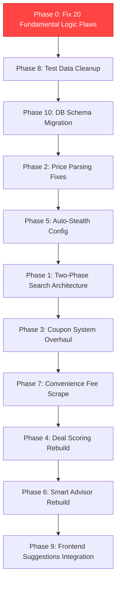

# Flight Finder — Comprehensive Fix & Enhancement Plan (v3)

This plan addresses **every issue** identified from a thorough audit of the codebase, your reported problems, **and all 20 newly discovered fundamental logic flaws** that silently produce incorrect results, leak resources, or cause race conditions. These new issues are in **Phase 0** — they represent the highest priority fixes needed to make the program robust.

---

## 🔴 PHASE 0: 20 FUNDAMENTAL LOGIC FLAWS

> [!CAUTION]
> These are **critical architectural bugs** that silently corrupt the program's core output — the "best deal" shown to the user — or lead to crashes and resource exhaustion. Fixing these first is essential for system stability and correctness.

### 1. Only ONE Flight Per Platform Saved — The "Best Deal" Is a Lie
- **Severity**: 🔴 CRITICAL
- **Files**: [dispatcher.py](file:///c:/Users/yasha/Desktop/Flight%20Finder/backend/dispatcher.py#L420) (line 420), [dispatcher.py](file:///c:/Users/yasha/Desktop/Flight%20Finder/backend/dispatcher.py#L256-L261)
- **What's broken**: The dispatcher scrapes multiple flights from each platform but immediately discards all but one (either the first result `flights[0]` or a specific flight number match).
- **Why it's devastating**: Only this single flight's price is saved, scored, and shown. Cheaper flights on the same platform are completely ignored.
- **Fix**: Iterate over all scraped flights (or at least the top 5 cheapest), apply coupon matching, calculate savings, score, and save each as a separate database result.

### 2. final_price vs checkout_price Mismatch in Results Database
- **Severity**: 🔴 CRITICAL
- **Files**: [dispatcher.py](file:///c:/Users/yasha/Desktop/Flight%20Finder/backend/dispatcher.py#L457-L491)
- **What's broken**: In the real worker flow, the results dict saves `final_price` as `savings_breakdown["checkout_price"]` (which has the convenience fee added back), but downstream logic (such as deal scoring and price history) operates on the pre-fee price. In the mock flow, it is saved pre-fee.
- **Why it's devastating**: Stored prices are inconsistent, making historical trends incorrect and cross-platform sorting unreliable.
- **Fix**: Standardize a single pricing pipeline: `scraped_price` → `coupon_discount` → `post_coupon_price` → `convenience_fee` → `final_checkout_price` → `auxiliary_savings` → `effective_price`.

### 3. Real Workers parse_current_price Returns Hardcoded 5500
- **Severity**: 🔴 CRITICAL
- **Files**: [google_flights_worker.py](file:///c:/Users/yasha/Desktop/Flight%20Finder/backend/workers/google_flights_worker.py#L260), [makemytrip_worker.py](file:///c:/Users/yasha/Desktop/Flight%20Finder/backend/workers/makemytrip_worker.py#L258), [easemytrip_worker.py](file:///c:/Users/yasha/Desktop/Flight%20Finder/backend/workers/easemytrip_worker.py#L294), [cleartrip_worker.py](file:///c:/Users/yasha/Desktop/Flight%20Finder/backend/workers/cleartrip_worker.py#L251)
- **What's broken**: Every real worker initializes `self._current_price = 5500.0` and `parse_current_price()` returns this hardcoded value without scraping the actual checkout price.
- **Why it's devastating**: If coupon brute-forcing is run, it compares discounts against a fake 5500 baseline rather than the actual price.
- **Fix**: Implement real DOM-based checkout price extraction in each worker's `parse_current_price` method.

### 4. aiosqlite Single Connection Used Concurrently Without Lock
- **Severity**: 🔴 CRITICAL (Race Condition)
- **Files**: [coupon_db.py](file:///c:/Users/yasha/Desktop/Flight%20Finder/backend/coupon_db.py#L22), [dispatcher.py](file:///c:/Users/yasha/Desktop/Flight%20Finder/backend/dispatcher.py)
- **What's broken**: Multiple parallel workers (running via `asyncio.gather`) execute SQL commands and commits concurrently on a single shared `aiosqlite` connection without any locking or transaction isolation.
- **Why it's devastating**: Uncommitted transactions interleave, leading to database errors, rollbacks affecting separate workers, or partial commits.
- **Fix**: Add a reentrant `asyncio.Lock()` to `CouponDB` to serialize database write/commit queries, or use a connection pool.

### 5. Fake Flight Numbers Destroy Cross-Platform Comparison
- **Severity**: 🔴 CRITICAL
- **Files**: All real workers in `backend/workers/`
- **What's broken**: Real workers generate random flight numbers (e.g. `6E-` + random integer) when DOM extraction fails.
- **Why it's devastating**: The same Indigo flight on MMT and Cleartrip gets different flight numbers. Cross-platform comparison, price history, and flight-specific coupon routing are broken.
- **Fix**: Extract actual flight numbers using regex from DOM text. If all else fails, generate a deterministic hash of `airline + departure_time + arrival_time`.

### 6. Mock Worker clear_coupon_field Always Resets to 5500
- **Severity**: 🔴 CRITICAL
- **Files**: [mock_worker.py](file:///c:/Users/yasha/Desktop/Flight%20Finder/backend/workers/mock_worker.py#L348), [coupon_brute_forcer.py](file:///c:/Users/yasha/Desktop/Flight%20Finder/backend/coupon_brute_forcer.py#L96-L114)
- **What's broken**: Resetting the coupon in the mock worker resets `_current_price` to exactly 5500, but real workers must reset to the actual baseline price (which might have been different).
- **Why it's devastating**: Brute-force calculations rely on a correct baseline reset; otherwise, discounts stack or calculate incorrectly.
- **Fix**: Save the initial price in the worker state when navigation finishes, and restore that exact baseline on coupon clearing.

### 7. MockWorker.is_at_checkout Checks Page Title but HTML Lacks Title Tag
- **Severity**: 🟡 MAJOR
- **Files**: [mock_worker.py](file:///c:/Users/yasha/Desktop/Flight%20Finder/backend/workers/mock_worker.py#L244-L293)
- **What's broken**: `is_at_checkout()` expects `"Checkout"` in the title, but the dynamically generated mock HTML does not include a `<title>` tag.
- **Why it's devastating**: The mock worker raises a `ValueError("Failed to navigate to final checkout screen")` on every test run, causing retry loops and mock pipeline failure.
- **Fix**: Add a `<title>Checkout</title>` to the dynamically generated HTML in the mock worker.

### 8. Brute Forcer Doesn't Verify Price Recovery After Clearing Coupon
- **Severity**: 🟡 MAJOR
- **Files**: [coupon_brute_forcer.py](file:///c:/Users/yasha/Desktop/Flight%20Finder/backend/coupon_brute_forcer.py#L96)
- **What's broken**: After a coupon fails pre-filtering or is cleared, the brute forcer never verifies that the page price actually returned to the baseline.
- **Why it's devastating**: If the clear operation fails or lags, the next coupon savings are computed on a corrupt base.
- **Fix**: Read the page price after clearing and wait/assert that it matches `baseline_price` before proceeding.

### 9. coupon_harvester.quick_harvest Never Fetches New Coupons (No-Op)
- **Severity**: 🟡 MAJOR
- **Files**: [coupon_harvester.py](file:///c:/Users/yasha/Desktop/Flight%20Finder/backend/coupon_harvester.py#L62-L91)
- **What's broken**: `quick_harvest()` checks TTLs but runs an empty list iteration (`new_coupons = []`) without executing actual scrapers. It then records the harvest timestamp anyway.
- **Why it's devastating**: The database is never populated with new/harvested coupons; the pre-search harvester run is a silent no-op.
- **Fix**: Implement the real crawler calls inside `quick_harvest` to pull coupons from DesiDime/GrabOn.

### 10. Nearby Dates Comparison Uses Apples-to-Oranges Pricing
- **Severity**: 🟡 MAJOR
- **Files**: [dispatcher.py](file:///c:/Users/yasha/Desktop/Flight%20Finder/backend/dispatcher.py#L527-L567)
- **What's broken**: The comparison compares the target date's coupon-discounted `final_price` against the alternative date's raw `base_price`.
- **Why it's devastating**: Suggests date shifts that look cheaper but aren't (or vice versa) because coupons were not applied to both sides.
- **Fix**: Compare raw `base_price` of the target date against raw `base_price` of alternative dates.

### 11. Yatra/Ixigo/Paytm Route to GoogleFlightsWorker But Stored as google_flights
- **Severity**: 🟡 MAJOR
- **Files**: [dispatcher.py](file:///c:/Users/yasha/Desktop/Flight%20Finder/backend/dispatcher.py#L673-L675)
- **What's broken**: Platforms without dedicated workers fallback to `GoogleFlightsWorker`, which overwrites results with the `"google_flights"` platform ID.
- **Why it's devastating**: Results are incorrectly grouped under Google Flights in the DB/UI, and platform-specific coupon matching fails.
- **Fix**: Pass the requested `platform_id` to the worker instance so it tags database entries and logs with the correct source identifier.

### 12. Smart Advisor Evaluates Only the First Worker's Flights
- **Severity**: 🟡 MAJOR
- **Files**: [dispatcher.py](file:///c:/Users/yasha/Desktop/Flight%20Finder/backend/dispatcher.py#L575-L585)
- **What's broken**: `get_advisory` is called inside the individual worker loop using only that worker's flights, rather than after all workers complete.
- **Why it's devastating**: The smart advisor cannot compare flights across platforms; the last worker to finish simply overwrites the advisory payload.
- **Fix**: Move the smart advisor call to the dispatcher's root execution block, running it after all workers have pushed results.

### 13. Browser Session Leak on Successful Searches
- **Severity**: 🟡 MAJOR (Resource Leak)
- **Files**: [dispatcher.py](file:///c:/Users/yasha/Desktop/Flight%20Finder/backend/dispatcher.py#L599-L609)
- **What's broken**: Successful worker sessions are kept open for UI takeover/handoff, but if the user closes the app or does not handoff, the browser remains alive.
- **Why it's devastating**: Orphaned Chromium processes accumulate, consuming hundreds of MBs of RAM and eventually crashing the host.
- **Fix**: Implement a background task that automatically closes and cleans up handoff sessions after a 5-minute timeout.

### 14. deal_scorer.py Gets Savings That Double-Counts Stacking Savings
- **Severity**: 🟡 MAJOR
- **Files**: [dispatcher.py](file:///c:/Users/yasha/Desktop/Flight%20Finder/backend/dispatcher.py#L313-L317), [dispatcher.py](file:///c:/Users/yasha/Desktop/Flight%20Finder/backend/dispatcher.py#L470-L474)
- **What's broken**: Savings passed to the scorer is `coupon_savings + (final_price - effective_price)`. Since `effective_price` incorporates convenience fees, the fee delta inflates or distorts the score.
- **Why it's devastating**: Deal scores are mathematically incorrect and fail to accurately represent the value of the deal.
- **Fix**: Pass raw coupon discount and stacked auxiliary savings as separate parameters to the scorer; adjust weights appropriately.

### 15. get_search_results Sorts by final_price Instead of effective_price
- **Severity**: 🟡 MAJOR
- **Files**: [coupon_db.py](file:///c:/Users/yasha/Desktop/Flight%20Finder/backend/coupon_db.py#L386)
- **What's broken**: SQLite result retrieval sorts entries by `final_price ASC`.
- **Why it's devastating**: The actual price paid by the user is `effective_price` (after cashback/rewards). Sorting by `final_price` ranks inferior deals higher.
- **Fix**: Change the SQL query to order results by `effective_price ASC`.

### 16. No Cross-Platform Result Ranking (Ranks are Hardcoded to 1)
- **Severity**: 🟡 MAJOR
- **Files**: [dispatcher.py](file:///c:/Users/yasha/Desktop/Flight%20Finder/backend/dispatcher.py#L342), [dispatcher.py](file:///c:/Users/yasha/Desktop/Flight%20Finder/backend/dispatcher.py#L499)
- **What's broken**: Stored results have `rank = 1` hardcoded under the assumption that the frontend will rank them, but the frontend displays the stored rank directly.
- **Why it's devastating**: All results appear with a "Rank 1" label, breaking UI sorting indicators.
- **Fix**: Calculate the true rank of each flight relative to the aggregated search results before writing to the database.

### 17. Geo-Location Price Differential Is Completely Fake
- **Severity**: 🟡 MAJOR
- **Files**: [dispatcher.py](file:///c:/Users/yasha/Desktop/Flight%20Finder/backend/dispatcher.py#L346-L380)
- **What's broken**: The geo-differential is generated via a random choice (`random.choice([120, 180, 250, 0])`) and written as a real observation (`_TIER3` route suffix).
- **Why it's devastating**: Pollutes the database with synthetic/fake price observations, degrading the forecast model's training accuracy.
- **Fix**: Delete the fake geo-location block entirely. If geo-pricing is implemented, use real proxy-routed scrapes.

### 18. Hardcoded Fallback Flights Silently Replace Failed Scrapes
- **Severity**: 🟡 MAJOR
- **Files**: Real workers in `backend/workers/`
- **What's broken**: When DOM parsing and vision fallback fail, workers return a fake fallback flight (e.g. Vistara UK-821 at 5600) rather than raising an error.
- **Why it's devastating**: Users are shown flights that do not exist, and the price predictor is trained on fake prices.
- **Fix**: Return an empty list `[]` and log a warning when scraping fails. The dispatcher will mark the platform as failed.

### 19. update_coupon_stats Unbounded Success Rate Drift
- **Severity**: 🟢 MINOR
- **Files**: [coupon_db.py](file:///c:/Users/yasha/Desktop/Flight%20Finder/backend/coupon_db.py#L135-L150)
- **What's broken**: Coupon success updates add/subtract flat values without sample-size weight or decay.
- **Why it's devastating**: Dead/expired coupons that worked historically remain ranked high for too long, delaying fresher coupons.
- **Fix**: Implement a sliding-window success rate or exponential moving average (EMA) decay for trust scores.

### 20. deactivate_expired Uses Naive Local Datetime Instead of UTC
- **Severity**: 🟢 MINOR
- **Files**: [coupon_db.py](file:///c:/Users/yasha/Desktop/Flight%20Finder/backend/coupon_db.py#L160-L167)
- **What's broken**: Deactivation uses local server time `datetime.now()` to compare against database timestamps (which are written in UTC).
- **Why it's devastating**: Coupons are deactivated early/late depending on server timezone offsets.
- **Fix**: Standardize on `datetime.now(timezone.utc).replace(tzinfo=None)` globally.

---

## 📋 ISSUES SUMMARY

| Issue ID | Description | Severity | Status |
| :--- | :--- | :--- | :--- |
| **NEW-1** | Only 1 flight saved per platform | 🔴 Critical | **Phase 0** |
| **NEW-2** | Stored `final_price` vs `checkout_price` mismatch | 🔴 Critical | **Phase 0** |
| **NEW-3** | Real workers return hardcoded 5500 on `parse_current_price` | 🔴 Critical | **Phase 0** |
| **NEW-4** | `aiosqlite` single connection race condition | 🔴 Critical | **Phase 0** |
| **NEW-5** | Fake flight numbers generated randomly | 🔴 Critical | **Phase 0** |
| **NEW-6** | Mock worker `clear_coupon` always resets to 5500 | 🔴 Critical | **Phase 0** |
| **NEW-7** | Mock worker HTML has no title, causing checkout validation crash | 🟡 Major | **Phase 0** |
| **NEW-8** | Brute forcer doesn't verify price reset | 🟡 Major | **Phase 0** |
| **NEW-9** | `coupon_harvester.quick_harvest` is a no-op | 🟡 Major | **Phase 0** |
| **NEW-10** | Nearby dates comparison uses apples-to-oranges price comparison | 🟡 Major | **Phase 0** |
| **NEW-11** | Fallback platforms routed to Google Flights write as google_flights | 🟡 Major | **Phase 0** |
| **NEW-12** | Smart advisor evaluates flights on a per-worker loop | 🟡 Major | **Phase 0** |
| **NEW-13** | Browser session leak on success | 🟡 Major | **Phase 0** |
| **NEW-14** | Deal scorer gets double-counted savings | 🟡 Major | **Phase 0** |
| **NEW-15** | `get_search_results` sorts by `final_price` instead of `effective_price` | 🟡 Major | **Phase 0** |
| **NEW-16** | All stored results are hardcoded to Rank 1 | 🟡 Major | **Phase 0** |
| **NEW-17** | Fake geo-location price differential written to price history | 🟡 Major | **Phase 0** |
| **NEW-18** | Hardcoded fallback flights on scrape failure | 🟡 Major | **Phase 0** |
| **NEW-19** | `update_coupon_stats` success rate drift | 🟢 Minor | **Phase 0** |
| **NEW-20** | Timezone mismatches on coupon deactivation | 🟢 Minor | **Phase 0** |
| **1** | Google Flights used for pricing (inflated) | 🔴 Critical | Phase 1 |
| **2** | Price parsing picks up promo/discount amounts | 🔴 Critical | Phase 2 |
| **3** | Coupon bank/card conflict (ICICI coupon + HDFC reward) | 🔴 Critical | Phase 3 |
| **4** | Coupons fixated on small hardcoded set | 🟡 Major | Phase 3 |
| **5** | Deal scoring formula issues | 🟡 Major | Phase 4 |
| **6** | Smart advisor suggestions hardcoded/fake | 🟡 Major | Phase 6 |
| **7** | Stealth/proxy settings exposed to user | 🟢 Minor | Phase 5 |
| **8** | Convenience fees inflating prices | 🟡 Major | Phase 7 |
| **9** | Test data contaminating real results | 🟡 Major | Phase 8 |
| **10** | Suggestions not clickable/interactive | 🟢 Minor | Phase 9 |

---

## 🙋 OPEN QUESTIONS (RETAINED)

> [!IMPORTANT]
> **Q1: Coupon Data Sources**
> **Answer**: Scrape both external platforms (GrabOn/DesiDime) AND on-site booking coupon drawers. Store as classified data. AI brain handles logic without vision for coupon pages.

> [!IMPORTANT]
> **Q2: Historical Price Data**
> **Answer**: Keep seed data for ML training only; exclude from deal scoring. Deal scoring must use real nearby date prices.

> [!IMPORTANT]
> **Q3: Convenience Fees**
> **Answer**: Scrape actual convenience fees from checkout pages dynamically.

---

## 🔧 PROPOSED CHANGES

### Phase 0: Fix 20 Fundamental Logic Flaws (Highest Priority)

#### [MODIFY] [dispatcher.py](file:///c:/Users/yasha/Desktop/Flight%20Finder/backend/dispatcher.py)
1. **Multi-Result Pipeline**: Save and emit the top 5 cheapest flights per platform instead of just `flights[0]`.
2. **Remove Geo-Differential**: Strip `location_price_diff` (lines 346-380). Record actual scraped base prices to history.
3. **Price Accounting**: Implement a single, clear pricing pipeline for both mock and real site execution:
   ```python
   scraped_price = flight["base_price"]
   coupon_discount = best_discount
   post_coupon_price = scraped_price - coupon_discount
   checkout_price = post_coupon_price + convenience_fee
   # Stacker runs on post_coupon_price
   savings_breakdown = await savings_stacker.calculate_all_savings(platform, post_coupon_price, profile, coupon["bank"])
   ```
4. **Nearby Date Scanning**: Move nearby date scans out of the per-platform loop. Execute raw base price comparison once post-aggregation.
5. **Session Management**: Add background task to track handoff sessions and kill browser instances after 5 minutes of inactivity.
6. **Smart Advisor Hook**: Run `smart_advisor.get_advisory()` once after all platform scrapers complete.
7. **Correct Worker Mapping**: Preserve original `platform_id` (e.g. `yatra`, `ixigo`) when routing fallback searches through `GoogleFlightsWorker`.

#### [MODIFY] [coupon_db.py](file:///c:/Users/yasha/Desktop/Flight%20Finder/backend/coupon_db.py)
1. **Database Lock**: Declare `self.lock = asyncio.Lock()` in `__init__`. Wrap all write transactions (`save_result`, `log_price`, etc.) in `async with self.lock:`.
2. **Effective Price Sorting**: Modify `get_search_results` to order queries by `effective_price ASC`.
3. **Result Ranking**: Implement a helper method to calculate relative ranks across aggregated search results.
4. **Standardize UTC Timestamps**: Update `deactivate_expired` to use `datetime.now(timezone.utc).replace(tzinfo=None)`.
5. **EMA success tracking**: Adjust `update_coupon_stats` to compute success rate using an exponential moving average.

#### [MODIFY] [coupon_harvester.py](file:///c:/Users/yasha/Desktop/Flight%20Finder/backend/coupon_harvester.py)
1. **Enable Scrapers**: Connect the crawler methods in `quick_harvest()` to harvest coupons from external sites instead of using empty lists.

#### [MODIFY] [coupon_brute_forcer.py](file:///c:/Users/yasha/Desktop/Flight%20Finder/backend/coupon_brute_forcer.py)
1. **Price Reset Verification**: Read the checkout page price after calling `clear_coupon_field`. Wait until the price returns to `baseline_price` before typing the next coupon.

#### [MODIFY] all worker files in `backend/workers/`
1. **Deterministic Flight Numbers**: Extract actual numbers using regex. Fallback to a deterministic hash: `airline[:2].upper() + "-" + hash(dep_time + arr_time)`.
2. **No Fake Fallbacks**: Return `[]` when DOM and vision parsing fail.
3. **Mock title tag**: Add `<title>Checkout</title>` to mock HTML.
4. **Worker parse_current_price**: Scrape real page prices instead of returning hardcoded 5500.

---

## 📈 UPDATED IMPLEMENTATION ORDER



---

## 🧪 VERIFICATION PLAN

### Automated Tests
Execute tests to check database locks, pricing pipelines, and worker extraction:
```powershell
cd backend
.\venv\Scripts\pytest.exe tests/
```

### Manual Verification Checklist
1. Verify database queries: No parallel write conflicts in log files.
2. Verify frontend result list: Results are sorted by `effective_price` and correctly display unique rank numbers.
3. Check browser processes: Run a search and ensure Chromium processes exit if handoff is not completed within 5 minutes.
4. Confirm fallback failures: Disable internet and ensure platform shows as "failed" rather than showing fake flight entries.
